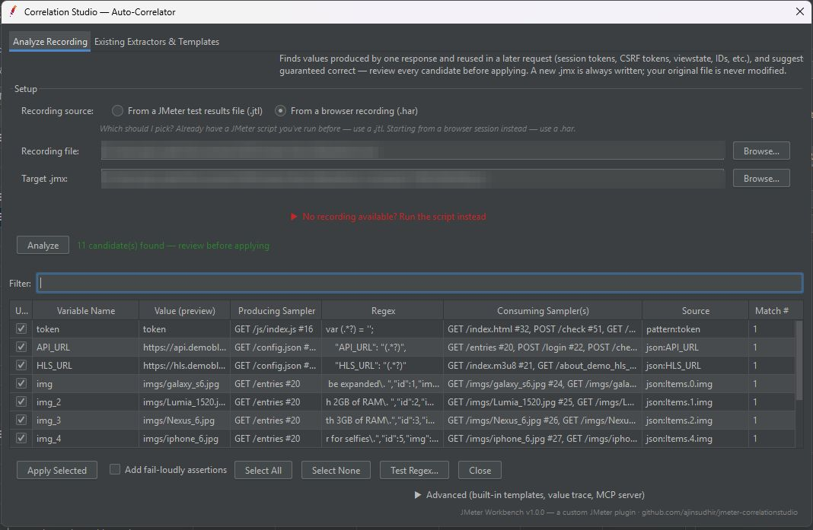
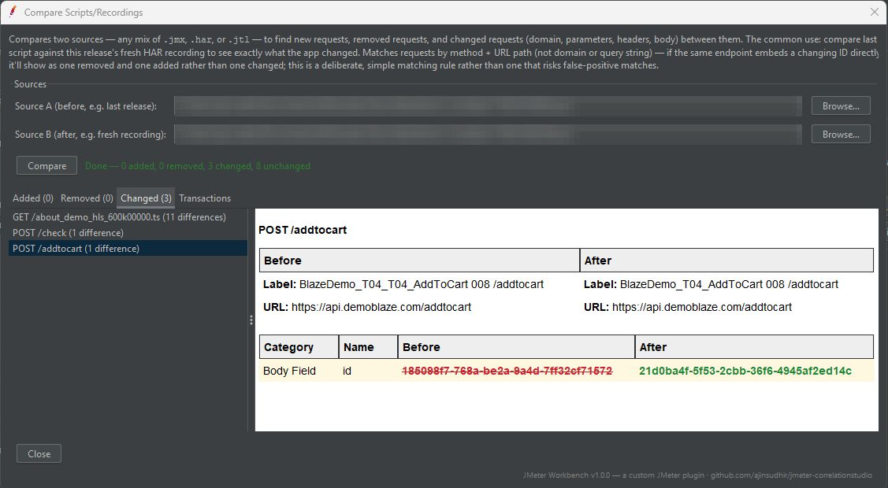
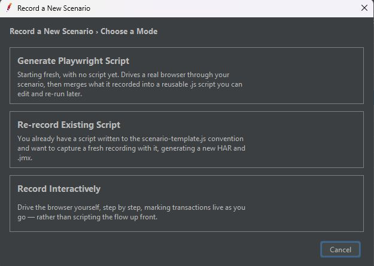
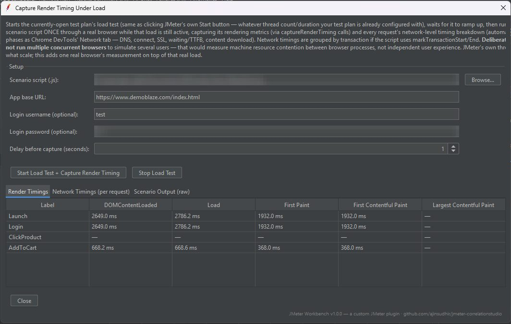
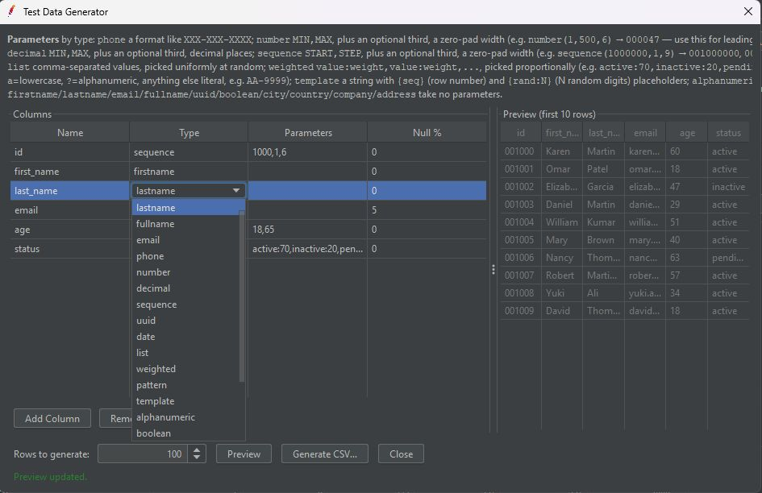
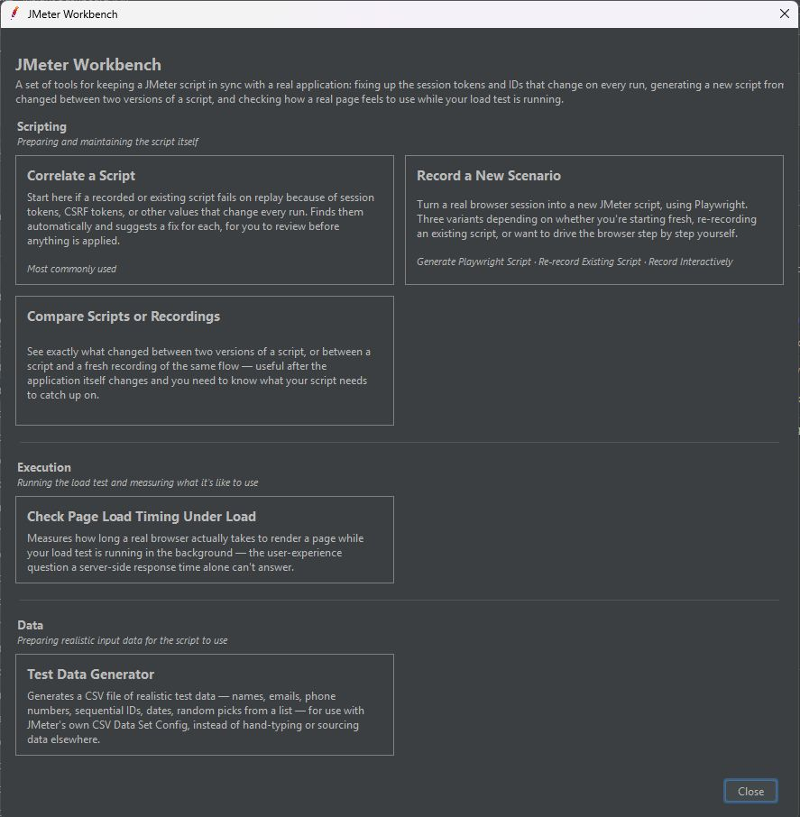

# SmartBlitz JMeter Workbench (Correlation Studio)


Re-script JMeter tests on every release. Auto-correlation, script comparison, Playwright recording, render timing under load and test data generation in one JMeter plugin.

Part of the **SmartBlitz AI for JMeter** toolkit. Overview and screenshots: https://ajinsudhir.github.io/jmeter-plugins.html

[](LICENSE)

## Features

- **Auto-Correlator.** Finds values that one response produces and a later request reuses (session tokens, CSRF tokens, viewstate, IDs), and suggests a Regular Expression Extractor plus variable substitution for each. Review, edit and approve in a table. A new `.jmx` is always written; your original is never modified. Heuristic, not guaranteed: review every candidate.
- **Templates.** Save extractors as reusable templates and apply them on the next release. Built-in templates cover common frameworks and platforms; scan a script for existing extractors, create your own rules, export and import.
- **Compare Scripts / Recordings.** Diff any mix of `.jmx`, `.har` and `.jtl` to see added, removed and changed requests with field-level before and after. Typical use: last release's script against this release's fresh recording.
- **Record a New Scenario.** One guided flow with three paths: generate a Playwright script from scratch, re-record an existing script that follows the scenario template, or record interactively. Produces a HAR and a `.jmx`.
- **Capture Render Timing Under Load.** Starts your load test, then replays the scenario once in a real browser while the load is active. Reports DOMContentLoaded, Load, First Paint, First and Largest Contentful Paint per transaction, plus per-request network timings (DNS, connect, SSL, TTFB, download).
- **Test Data Generator.** Table-based column editor with names, emails, phones, dates, UUIDs, sequences and numbers (zero-padded if needed), lists, weighted values, patterns and templates. Preview, then generate a CSV.
- **Fail loudly.** Optional assertions so a correlation that silently extracts nothing fails the test instead of passing quietly.

## Screenshots


*Auto-Correlator: review every candidate before anything is written*


*Compare Scripts / Recordings: what changed since the last release*


*Record a New Scenario with Playwright*


*Capture Render Timing Under Load*


*Test Data Generator*


*The Workbench launcher*

## Requirements

- Apache JMeter 5.6.3 (built and tested against it; other 5.6.x likely compatible)
- Java 11 or newer
- Node.js and Playwright, only for the recording and scenario features. The plugin manages its own Playwright install under `~/.jmeter-correlationstudio/`. Correlation and compare work without it.

## Install

1. Download `jmeter-correlationstudio-1.0.0.jar` from [Releases](../../releases).
2. Copy it into `<JMETER_HOME>/lib/ext/`.
3. Restart JMeter.

Open it from **Tools → SmartBlitz - JMeter Workbench...** (also a toolbar icon). No account, no telemetry.

## Build from source

Requires Maven and JDK 11 or newer.

```
mvn clean package
```

The jar is written to `target/jmeter-correlationstudio.jar`. To build against another JMeter version, change `<jmeter.version>` in `pom.xml`.

## Related plugins

- [MCP Bridge for JMeter](https://github.com/ajinsudhir/jmeter-mcpbridge): generic test-plan tools for AI agents, split out of this plugin.
- [Insight Dashboard for JMeter](https://github.com/ajinsudhir/jmeter-insightdashboard): live per-transaction results listener.

## Docs

- [Playwright scenarios: how to record a scenario](playwright-scenarios/HOW-TO-RECORD-A-SCENARIO.md)
- [Detailed changelog and design notes](CHANGELOG.md)

## License

Apache 2.0, see [LICENSE](LICENSE).

## Author

Ajin Sudhir, [github.com/ajinsudhir](https://github.com/ajinsudhir)
